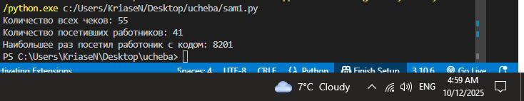
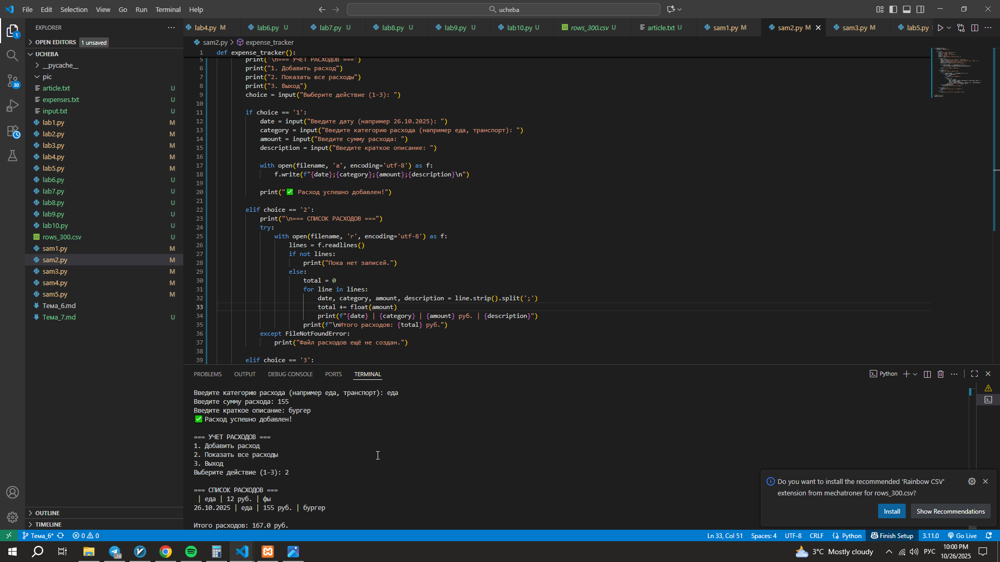
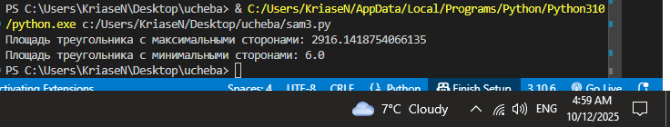
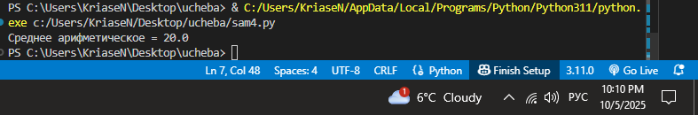
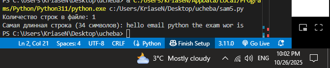

# Тема 4. Функции и стандартные модули/библиотеки
Отчет по Теме #4 выполнил(а):
- Носов Никита Дмитриевич
- ИВТ-23-2

| Задание | Лаб_раб | Сам_раб |
| ------ | ------ | ------ |
| Задание 1 | + | + |
| Задание 2 | + | + |
| Задание 3 | + | + |
| Задание 4 | + | + |
| Задание 5 | + | + |
| Задание 6 | + |  |
| Задание 7 | + |  |
| Задание 8 | + |  |
| Задание 9 | + |  |
| Задание 10 | + |  |

знак "+" - задание выполнено; знак "-" - задание не выполнено;

Работу проверили:
- к.э.н., доцент Панов М.А.

## Лабораторная работа №1
### Напишите функцию, которая выполняет любые арифметические действия и выводит результат в консоль. Вызовите функцию используя “точку входа”.

```python
def main():
    print(2+2)
if __name__ == '__main__':
    main()
```
### Результат.


## Выводы

Эта функция **`main`** выполняет простое арифметическое действие, а затем **выводит результат** сразу в консоль внутри себя, используя "точку входа" программы.

## Лабораторная работа №2
### Напишите функцию, которая выполняет любые арифметические действия, возвращает при помощи return значение в место, откуда вызывали функцию. Выведите результат в консоль. Вызовите функцию используя “точку входа”.

```python
def main():
    return 2+2
if __name__ == '__main__':
    print(main())
```
### Результат.


## Выводы

Функция **`main`** выполняет расчет и **возвращает результат** с помощью оператора `return`. Вывод в консоль осуществляется уже после вызова функции в основной части программы.

## Лабораторная работа №3
### Напишите функцию, в которую передаются два аргумента, над ними производится арифметическое действие, результат возвращается туда, откуда эту функцию вызывали. Выведите результат в консоль. Вызовите функцию в любом небольшом цикле.

```python
def main(one, two):
return one + two
for i in range(5):
answer = main(one=1, two=10)
print(answer)
```
### Результат.


## Выводы

Эта функция принимает два аргумента и складывает их, а затем вызывается в цикле **пять раз**, демонстрируя повторное использование кода.

## Лабораторная работа №4
### Напишите функцию, на вход которой подается какое-то изначальное неизвестное количество аргументов, над которыми будет производится арифметические действия. Для выполнения задания необходимо использовать кортеж “*args”. 

```python
def main(x, *args):
	one = x
	two = sum(args)
	three = float(len(args))
	print(f"one={one}\ntwo={two}\nthree={three}")
	return x + sum(args) / float(len(args))
  
if __name__ == '__main__':
	result = main(10, 0, 1, 2, -1, 0, -1, 1, 2)
	print(f"\nresult={result}")
```
### Результат.


## Выводы

Функция показывает, как можно работать с **переменным числом позиционных аргументов** с помощью `*args`, используя их для расчета среднего значения и вывода промежуточных переменных.

## Лабораторная работа №5
### Напишите функцию, которая на вход получает кортеж “**kwargs” и при помощи цикла выводит значения, поступившие в функцию. На скриншоте ниже указаны два варианта вызова функции с “**kwargs” и два варианта работы с данными, поступившими в эту функцию. Комментарии в коде и теоретическая часть помогут вам разобраться в этом нелегком аспекте. Вызовите функцию используя “точку входа”.

```python
def main(**kwargs):
    for i in kwargs.items():
        print(i[0], i[1])
    print()
    for key in kwargs:
        print(f"{key} = {kwargs[key]}")

if __name__ == '__main__':
    main(x=[1, 2, 3], y=[3, 3, 0], z =[2, 3, 0], q=[3, 3, 0], w=[3, 3, 0])
    print()
    main(**{'x': [1, 2, 3], 'y': [3, 3, 0]})
```
### Результат.


## Выводы

Этот пример демонстрирует, как функция может принимать **произвольное количество именованных аргументов** в виде словаря с помощью `**kwargs`, а затем итерироваться по ним для вывода ключей и значений.

## Лабораторная работа №6
### Напишите две функции. Первая – получает в виде параметра “**kwargs”. Вторая считает среднее арифметическое из значений первой функции. Вызовите первую функцию используя “точку входа” и минимум 4 аргумента.

```python
def mean(data):
	return sum(data) / float(len(data))
def main(**kwargs):
	for i, j in kwargs.items():
	print(f"{i}. Значение = {mean(j)}")

if __name__ == '__main__':

	main(X=[1, 2, 3], Y=[3, 3, 0])
```
### Результат.


## Выводы

Здесь реализован принцип **разделения ответственности**, где функция `mean` отвечает за расчет среднего значения, а функция `main` использует её для обработки данных из словаря.

## Лабораторная работа №7
### Создайте дополнительный файл .py. Напишите в нем любую функцию, которая будет что угодно выводить в консоль, но не вызывайте ее в нем. Откройте файл main.py, импортируйте в него функцию из нового файла и при помощи “точки входа” вызовите эту функцию.

```python
from for_import import say_hello
	if __name__ == '__main__':
	say_hello()
```
### Результат.


## Выводы

Этот код показывает, как использовать **модульность** в Python, импортируя и вызывая функцию `say_hello` из отдельного файла `for_import.py`.
## Лабораторная работа №8
### Напишите программу, которая будет выводить корень, синус, косинус полученного от пользователя числа.

```python
import math
def main():
	value = int(input('Введите значение: '))
	print(math.sqrt(value))
	print(math.sin(value))
	print(math.cos(value))

if __name__ == '__main__':

	main()
```
### Результат.


## Выводы

Программа демонстрирует использование встроенного модуля **`math`** для выполнения сложных математических операций, таких как извлечение квадратного корня и расчет тригонометрических функций.

## Лабораторная работа №9
### Напишите программу, которая будет рассчитывать какой день недели будет через n-нное количество дней, которые укажет пользователь.

```python
from datetime import datetime as dt
from datetime import timedelta as td
def main():
today = dt.today()

n = int(input('Введите количество дней: '))  
result = today + td(days=n)
print(
f"Сегодня {dt.today().date()}. "
f"День недели {dt.today().isoweekday()}"
)
print(
f"Через {n} дней будет {result.date()}. "
f"День недели {result.isoweekday()}"
)

if __name__ == '__main__':
	main()
```
### Результат.


## Выводы

Код использует библиотеку **`datetime`** для определения дня недели сегодня и расчета, какой день недели будет через заданное пользователем количество дней.

## Лабораторная работа №10
### Напишите программу с использованием глобальных переменных, которая будет считать площадь треугольника или прямоугольника в зависимости от того, что выберет пользователь. Получение всей необходимой информации реализовать через input(), а подсчет площадей выполнить при помощи функций. Результатом программы будет число, равное площади, необходимой фигуры.

```python
global result
def rectangle():
	
	a = float(input("Ширина: "))
	b = float(input("Высота: "))
	global result
	result = a * b
def triangle():
	
	a = float(input("Основание: "))
	h = float(input("Высота: "))
	global result
	result = 0.5 * a * h

  

figure = input("1 - прямоугольник, 2 - треугольник: ")

if figure == '1':
rectangle()
if figure == '2':
triangle()
print(f"Площадь: {result}")
```
### Результат.


## Выводы

В данном коде сначала объявляется глобальная переменная result и описываются функции rectangle() и triangle(). В зависимости от того, какую цифру введет пользователь (1 или 2), вызовется соответствующая функция. От пользователя также дополнительно потребуется ввести нужные для расчета площади параметры фигуры, после чего выведется посчитанная площадь фигуры.

## Самостоятельная работа №1
### Дайте подробный комментарий для кода, написанного ниже. Комментарий нужен для каждой строчки кода, нужно описать что она делает. Не забудьте, что функции комментируются по-особенному.

```python
#Импорт класса datetime из библиотеки datetime
from datetime import datetime
#Импорт функции sqrt из библиотеки math
from math import sqrt

#Функция, принимающая любое количество аргументов в виде словаря
def main(**kwargs):
    """
    Вычисляет длину вектора по теореме Пифагора
    Параметры:
        **kwargs (словарь) - элементы со значениями начала и конца вектора
    Возвращает:
        float: длина вектора
    """
    #Проходимся по элементам kwargs с ключом key
    for key in kwargs.items():
        #Вычисление длины вектора по теореме Пифагора 
        result = sqrt(key[1][0] ** 2 + key[1][1] ** 2)
        #Вывод посчитанного результата
        print(result)
        
#Проверка "точки входа"
if __name__ == '__main__':
    #Запоминается начальное время перед началом вызова функции main
    start_time = datetime.now()
    #Вызов функции main, куда передаются наборы из 2 значений - списки
    main(
        one = [10, 3],
        two = [5, 4],
        three = [15, 13],
        four = [93, 53],
        five = [133, 15]
    )
    #Вычисляется время выполнения программы, т.е. из текущего вычитается зафиксированное
    time_costs = datetime.now() - start_time
    #Выводится время выполнения программы - значение time_costs
    print(f"Время выполнения программы - {time_costs}")
```
### Результат.


## Выводы

В данном коде функции main() передаются наборы значений, составляющие в итоге словарь. По этим наборам значений вычисляются и выводятся длины векторов. В консоль также выводится время выполнения программы, которое начинает считаться перед вызовом функции main().

## Самостоятельная работа №2
### Напишите программу, которая будет заменять игральную кость с 6 гранями. Если значение равно 5 или 6, то в консоль выводится «Вы победили», если значения 3 или 4, то вы рекурсивно должны вызвать эту же функцию, если значение 1 или 2, то в консоль выводится «Вы проиграли». При этом каждый вызов функции необходимо выводить в консоль значение “кубика”. Для выполнения задания необходимо использовать стандартную библиотеку random. Программу нужно написать, используя одну функцию и “точку входа”

```python
import random
def dice_game():
	roll = random.randint(1, 6)
	print(f"Выпало значение: {roll}")
	if roll in [5, 6]:
		print("Вы победили")
	elif roll in [3, 4]:
		dice_game()
	elif roll in [1, 2]:
		print("Вы проиграли")
if __name__ == '__main__':
	dice_game()
```
### Результат.


## Выводы

Эта программа — пример **рекурсивной функции**, которая симулирует игру с 6-гранной костью. Исход определяется выпавшим числом: 5 или 6 — победа (завершение), 1 или 2 — поражение (завершение), а 3 или 4 приводят к **повторному вызову** самой себя (рекурсии), пока не будет достигнут победный или проигрышный исход.

## Самостоятельная работа №3
### Напишите программу, которая будет выводить текущее время, с точностью до секунд на протяжении 5 секунд. Программу нужно написать с использованием цикла. Подсказка: необходимо использовать модуль datetime и time, а также вам необходимо как-то “усыплять” программу на 1 секунду.

```python
import datetime as dt, time
def funct():
    for i in range(5):
        currentTime = dt.datetime.now()
        print(currentTime.strftime("%H:%M:%S"))
        time.sleep(1)
if __name__ == '__main__':
    funct()
```
### Результат.


## Выводы

В данном коде импортируются и далее используются библиотеки datetime (как dt) и time. С помощью "точки входа" вызывается функция funct(), в которой цикл прорабатывает 5 раз. Каждый раз он выводит текущее время в определенном формате и на секунду приостанавливает работу.

## Самостоятельная работа №4
### Напишите программу, которая считает среднее арифметическое от аргументов вызываемое функции, с условием того, что изначальное количество этих аргументов неизвестно. Программу необходимо реализовать используя одну функцию и “точку входа”.

```python
def funct(*args):
    if len(args) == 0:
        return 0
    return sum(args) / len(args)
if __name__ == '__main__':
    result = funct(10, 20, 30, 20)
    print(f"Среднее арифметическое = {result}")
```
### Результат.


## Выводы

В данном коде с помощью "точки входа" вызывается функция funct с различным числом аргументов (в данном случае 4). Если число аргументов = 0, то возвращается 0. В ином случае функция возвращает сумму аргументов, разделенную на их количество, т.е. среднее арифметическое. Результат присваивается переменной result и выводится в консоль.

## Самостоятельная работа №5
### Создайте два Python файла, в одном будет выполняться вычисление площади треугольника при помощи формулы Герона (необходимо реализовать через функцию), а во втором будет происходить взаимодействие с пользователем (получение всей необходимой информации и вывод результатов). Напишите эту программу и выведите в консоль полученную площадь.

```python
from module import area
def main():
	print("Расчет площади треугольника")
	side_a = float(input("Введите длину стороны a: "))
	side_b = float(input("Введите длину стороны b: "))
	side_c = float(input("Введите длину стороны c: "))
	calc_area = area(side_a, side_b, side_c)
	print(f"\nДлины сторон: a={side_a}, b={side_b}, c={side_c}")
	print(f"Полученная площадь треугольника: {calc_area:.2f}") 
if __name__ == '__main__':
	main()

import math
def area(a, b, c):
	s = (a + b + c) / 2
	area = math.sqrt(s * (s - a) * (s - b) * (s - c))
	return area
```
### Результат.


## Выводы

Программа разделена на два **модуля** (`module.py` и `sam5.py`), демонстрируя принцип **модульности** в Python. Она использует математическую **формулу Герона** для точного вычисления площади треугольника по длинам трех сторон, при этом отделяя логику вычислений от пользовательского ввода/вывода.

## Общие выводы по теме
Функции — незаменимый инструмент в программировании, позволяющий группировать повторяющиеся блоки кода для создания более чистых и организованных программ. Они могут быть готовыми (импортируемыми из библиотек) или пользовательскими (написанными под конкретную задачу). Гибкость функций заключается в возможности принимать фиксированное, произвольное или даже необязательное число аргументов, что критически важно учитывать при их разработке.
