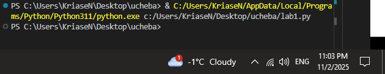
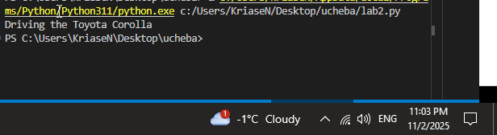
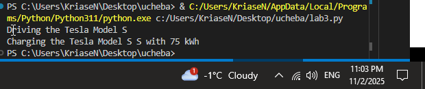
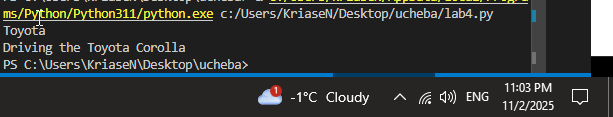
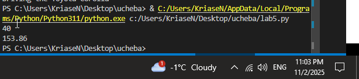
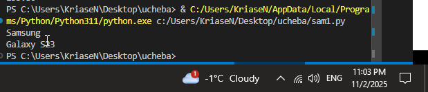
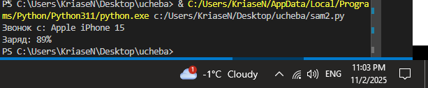
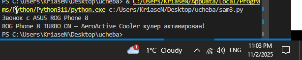
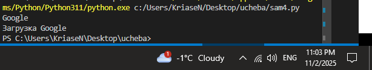
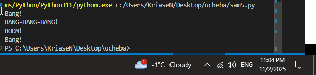

# Тема 8. Основы объектно-ориентированного программирования
Отчет по Теме #8 выполнил(а):
- Носов Никита Дмитриевич
- ИВТ-23-2

| Задание | Лаб_раб | Сам_раб |
| ------ | ------ | ------ |
| Задание 1 | + | + |
| Задание 2 | + | + |
| Задание 3 | + | + |
| Задание 4 | + | + |
| Задание 5 | + | + |

знак "+" - задание выполнено; знак "-" - задание не выполнено;

Работу проверили:
- к.э.н., доцент Панов М.А.

## Лабораторная работа №1
### Создайте класс “Car” с атрибутами производитель и модель. Создайте объект этого класса. Напишите комментарии для кода, объясняющие его работу. Результатом выполнения задания будет листинг кода с комментариями.

```python
class Car:
    def __init__(self, make, model):
        self.make = make
        self.model = model

my_car = Car("Toyota", "Corolla")
```
### Результат.



## Выводы
Создан базовый класс `Car` с двумя публичными атрибутами: `make` (производитель) и `model` (модель). Экземпляр `my_car` инициализирован значениями `"Toyota"` и `"Corolla"`. Код демонстрирует простейшее создание объекта и работу конструктора `__init__`.

## Лабораторная работа №2
### Дополните код из первого задания, добавив в него атрибуты и методы класса, заставьте машину “поехать”.

```python
class Car:
    def __init__(self, make, model):
        self.make = make
        self.model = model

    def drive(self):
        print(f"Driving the {self.make} {self.model}")

my_car = Car("Toyota", "Corolla")
my_car.drive()
```
### Результат.


## Выводы
К классу `Car` добавлен метод `drive()`, который выводит сообщение о движении конкретного автомобиля. При вызове `my_car.drive()` в консоль выводится строка `Driving the Toyota Corolla`, что подтверждает корректную работу метода и доступа к атрибутам экземпляра.

## Лабораторная работа №3
### Создайте новый класс “ElectricCar” с методом “charge” и атрибутом емкость батареи. Реализуйте его наследование от класса Car.

```python
class Car:
    def __init__(self, make, model):
        self.make = make
        self.model = model

    def drive(self):
        print(f"Driving the {self.make} {self.model}")

class ElectricCar(Car):
    def __init__(self, make, model, battery_capacity):
        super().__init__(make, model)
        self.battery_capacity = battery_capacity

    def charge(self):
        print(f"Charging the {self.make} {self.model} S with {self.battery_capacity} kWh")

my_electric_car = ElectricCar("Tesla", "Model S", 75)
my_electric_car.drive()
my_electric_car.charge()
```
### Результат.


## Выводы
Класс `ElectricCar` наследует поведение базового `Car` через `super().__init__`. Добавлен новый атрибут `battery_capacity` и метод `charge()`. Объект `my_electric_car` успешно использует унаследованный метод `drive()` и собственный `charge()`, демонстрируя принципы наследования и расширения функциональности.

## Лабораторная работа №4
### Реализуйте инкапсуляцию для класса Car: защищённый атрибут производителя и приватный атрибут модели.

```python
class Car:
    def __init__(self, make, model):
        self._make = make      # Защищённый атрибут
        self.__model = model   # Приватный атрибут

    def drive(self):
        print(f"Driving the {self._make} {self.__model}")

my_car = Car("Toyota", "Corolla")
print(my_car._make)        # Доступ к защищённому атрибуту
# print(my_car.__model)    # Ошибка! Приватный атрибут не доступен
my_car.drive()
```
### Результат.


## Выводы
В классе `Car` реализована инкапсуляция: `_make` — защищённый (доступен по соглашению), `__model` — приватный (недоступен извне). Доступ к `_make` возможен, попытка обращения к `__model` вызывает ошибку. Метод `drive()` корректно использует оба атрибута.

## Лабораторная работа №5
### Реализуйте полиморфизм: базовый класс Shape и два дочерних класса Rectangle и Circle с методом area().

```python
class Shape:
    def area(self):
        pass

class Rectangle(Shape):
    def __init__(self, width, height):
        self.width = width
        self.height = height

    def area(self):
        return self.width * self.height

class Circle(Shape):
    def __init__(self, radius):
        self.radius = radius

    def area(self):
        return 3.14 * self.radius * self.radius

shapes = [
    Rectangle(5, 8),
    Circle(7)
]

for shape in shapes:
    print(shape.area())
```
### Результат.


## Выводы
Базовый класс `Shape` объявляет интерфейс `area()`. Дочерние классы `Rectangle` и `Circle` переопределяют его по-разному. Цикл по списку `shapes` вызывает правильную реализацию метода для каждого объекта, демонстрируя полиморфизм во время выполнения.

## Самостоятельная работа №1
```python
class Smartphone:
    def __init__(self, brand, model):
        self.brand = brand
        self.model = model

phone = Smartphone("Samsung", "Galaxy S23")
print(phone.brand)
print(phone.model)
```
### Результат.


## Выводы
Создан собственный класс `Smartphone` с двумя атрибутами. Экземпляр `phone` инициализирован и успешно выводит значения атрибутов, подтверждая корректную работу конструктора.

## Самостоятельная работа №2
```python
class Smartphone:
    def __init__(self, brand, model, battery):
        self.brand = brand
        self.model = model
        self.battery = battery

    def call(self):
        print(f"Звонок с: {self.brand} {self.model}")

    def charge_level(self):
        print(f"Заряд: {self.battery}%")

phone = Smartphone("Apple", "iPhone 15", 89)
phone.call()
phone.charge_level()
```
### Результат.


## Выводы
К классу `Smartphone` добавлены атрибут `battery` и два метода. Вызовы `call()` и `charge_level()` выводят информацию о звонке и уровне заряда, показывая расширение функциональности объекта.

## Самостоятельная работа №3
```python
class Smartphone:
    def __init__(self, brand, model, battery):
        self.brand = brand
        self.model = model
        self.battery = battery

    def call(self):
        print(f"Звонок с {self.brand} {self.model}")

class GamingPhone(Smartphone):
    def __init__(self, brand, model, battery, cooling):
        super().__init__(brand, model, battery)
        self.cooling = cooling

    def turbo_mode(self):
        print(f"{self.model} TURBO ON — {self.cooling} кулер активирован!")

rog = GamingPhone("ASUS", "ROG Phone 8", 95, "AeroActive Cooler")
rog.call()
rog.turbo_mode()
```
### Результат.


## Выводы
Создан дочерний класс `GamingPhone`, унаследовавший все от `Smartphone`. Добавлен атрибут `cooling` и метод `turbo_mode()`. Объект `rog` использует унаследованный `call()` и собственный `turbo_mode()`, демонстрируя практическое наследование.

## Самостоятельная работа №4
```python
class Smartphone:
    def __init__(self, brand, model):
        self._brand = brand      # protected
        self.__model = model     # private

    def boot(self):
        print(f"Загрузка {self._brand}")

phone = Smartphone("Google", "Pixel 9")
print(phone._brand)          # OK
# print(phone.__model)       # ERROR
phone.boot()
```
### Результат.


## Выводы
В классе `Smartphone` реализована инкапсуляция: `_brand` — защищённый, `__model` — приватный. Доступ к `_brand` возможен, к `__model` — запрещён. Метод `boot()` использует защищённый атрибут.

## Самостоятельная работа №5
```python
class Weapon:
    def fire(self):
        pass

class Pistol(Weapon):
    def fire(self):
        return "Bang!"

class Rifle(Weapon):
    def fire(self):
        return "BANG-BANG-BANG!"

class Sniper(Weapon):
    def fire(self):
        return "BOOM!"

guns = [Pistol(), Rifle(), Sniper(), Pistol()]
for gun in guns:
    print(gun.fire())
```
### Результат.


## Выводы
Базовый класс `Weapon` задаёт интерфейс `fire()`. Три подкласса переопределяют его по-своему. Цикл по списку `guns` вызывает нужную реализацию для каждого объекта, ярко иллюстрируя полиморфизм.

## Общие выводы по теме
- ООП в Python строится на трёх столпах: **наследование** (переиспользование кода), **инкапсуляция** (сокрытие реализации), **полиморфизм** (единый интерфейс — разные поведения).  
- Лабораторные и самостоятельные задания показали, как создавать классы, расширять их через наследование, защищать данные и использовать полиморфизм для гибкой работы с разнотипными объектами.  
- Практическое применение этих концепций позволяет писать чистый, масштабируемый и легко поддерживаемый код.